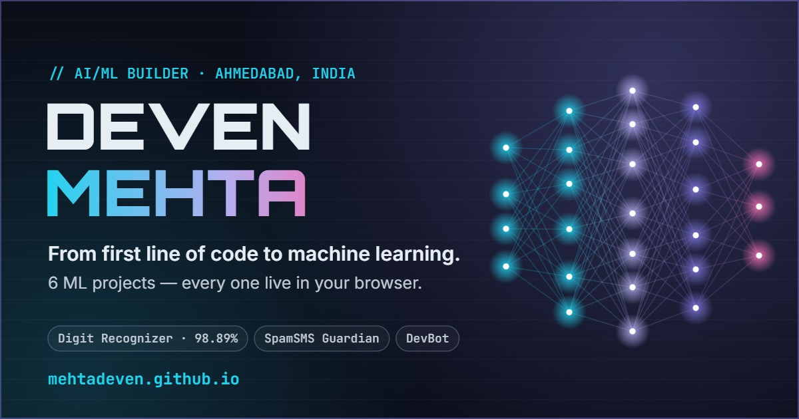

# mehtadeven.github.io

My portfolio: **[mehtadeven.github.io](https://mehtadeven.github.io/)**, a 3D, scroll-driven "forward pass" through my path into AI/ML. Each layer of the network is one stage of the journey, and all six projects run live in the browser.

## How it's built

- **No build step.** Plain HTML, CSS and JavaScript modules, served as-is by GitHub Pages.
- **Three.js** (bundled locally in `assets/vendor/`) draws the scene in `assets/js/scene.js`: a small neural network in the hero, then one 3D "layer" per journey chapter. These include a real 8×8 digit from the scikit-learn dataset as voxels, a word-vector sphere, a film-similarity graph, and the full-stack layers of SpamSMS Guardian.
- **Scroll drives the camera.** Every element with `data-station="N"` is an anchor, and the camera rests at station N while that section is centred.
- **Accessible fallbacks.** All content is plain HTML. Without WebGL the page shows a static gradient, and `prefers-reduced-motion` turns idle animation off.
- **Self-hosted fonts:** Orbitron, Inter and JetBrains Mono (SIL Open Font License; licence files sit next to the fonts).

## Editing

| What | Where |
| --- | --- |
| Text, projects, education | `index.html` |
| LinkedIn / email buttons | `PROFILE` at the top of `assets/js/site.js` (the buttons appear once a link is set) |
| Colours, layout | `assets/css/style.css` |
| 3D scene | `assets/js/scene.js` |
| Link preview image (LinkedIn, WhatsApp…) | `assets/img/og-image.jpg` (1200×630) |

Preview locally with `python -m http.server` in this folder, then open http://localhost:8000.

## Live project demos

| Project | Demo | Code |
| --- | --- | --- |
| Resume-Job Matcher | [live](https://mehtadeven.github.io/resume-job-matcher/) | [repo](https://github.com/mehtadeven/resume-job-matcher) |
| SpamSMS Guardian | [live](https://mehtadeven.github.io/spam-sms-checker/) | [repo](https://github.com/mehtadeven/spam-sms-checker) |
| Digit Recognizer | [live](https://mehtadeven.github.io/digit-recognizer-ml/) | [repo](https://github.com/mehtadeven/digit-recognizer-ml) |
| DevBot | [live](https://mehtadeven.github.io/ai-chatbot-python/) | [repo](https://github.com/mehtadeven/ai-chatbot-python) |
| Movie Recommender | [live](https://mehtadeven.github.io/movie-recommender-ai/) | [repo](https://github.com/mehtadeven/movie-recommender-ai) |
| Text Summarizer | [live](https://mehtadeven.github.io/text-summarizer-ai/) | [repo](https://github.com/mehtadeven/text-summarizer-ai) |
